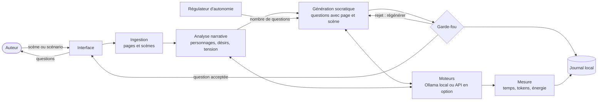

# Contrechamp

> **Le co-auteur qui ne tient jamais le stylo.**

Contrechamp est une IA socratique pour les jeunes cinéastes tunisiens.
Elle lit un scénario, en derja écrite en lettres latines ou en français, et pose des questions pour débloquer l'écriture.
Elle n'écrit jamais une ligne à la place de l'auteur.

> **Projet en phase de conception.** Ce dépôt contient l'architecture, la documentation et le squelette du code. Aucune fonctionnalité n'est encore implémentée : chaque fonction lève `NotImplementedError`. Le statut de chaque brique est indiqué [plus bas](#létat-du-projet).

Projet conçu pour le hackathon « IA Éthique 360 » (OIF × Junior Entreprise INSAT).

---

## Sommaire

1. [Le problème](#le-problème)
2. [La solution](#la-solution)
3. [La place de l'IA](#la-place-de-lia)
4. [L'architecture](#larchitecture)
5. [La structure du dépôt](#la-structure-du-dépôt)
6. [Éthique à 360°](#éthique-à-360)
7. [L'état du projet](#létat-du-projet)
8. [La feuille de route](#la-feuille-de-route)
9. [L'équipe et la répartition des tâches](#léquipe-et-la-répartition-des-tâches)
10. [L'utilisation de l'IA dans ce projet](#lutilisation-de-lia-dans-ce-projet)
11. [La licence](#la-licence)

---

## Le problème

### Le constat

En Tunisie, et surtout hors de Tunis, beaucoup de jeunes cinéastes écrivent leur premier film seuls : sans formation, sans lecteur, sans mentor. Personne ne relit leur scénario, ne leur demande ce que veut leur personnage ou pourquoi une scène ne tient pas.

Les IA actuelles ne comblent pas ce manque : elles écrivent à leur place. L'auteur obtient un texte, mais il n'apprend rien, et le film n'est plus tout à fait le sien.

**Qui est concerné :** les jeunes auteurs et autrices de premiers films (courts métrages surtout), autodidactes, éloignés des écoles et des réseaux du cinéma, qui écrivent en derja, en français ou en arabe.

### Les sources

- *La Presse* (2025), article sur Jaleleddine, primé au FIFAK sans formation en cinéma. Lien : À COMPLÉTER.
- *Kapitalis*. Titre et lien : À COMPLÉTER.
- *L'Économiste Maghrébin*. Titre et lien : À COMPLÉTER.

### Comment nous avons détecté le problème

À COMPLÉTER par l'équipe : travail de terrain mené, personnes rencontrées (jeunes cinéastes, ciné-clubs, festivals, formateurs), ce qu'elles nous ont dit.

---

## La solution

### La méthode socratique

Contrechamp ne donne pas de réponses : il pose des questions. Comme Socrate, il part de ce que l'auteur a déjà écrit et l'aide à trouver lui-même ce qui manque. Chaque question est courte, s'appuie sur un passage précis du scénario, et l'auteur reste libre de l'ignorer.

### L'histoire de Leila

Leila a 22 ans. Elle écrit son premier court métrage sur sa grand-mère, qui refuse de quitter sa maison.

Quand Leila était petite, sa grand-mère ne lui donnait jamais la suite des histoires. Elle demandait : **« Et après ? »**. C'était à Leila de l'inventer.

Contrechamp reprend ce rôle. Il ne raconte pas la suite : il demande « Et après ? ».

### Un exemple concret

Leila envoie sa scène : *« Ma grand-mère refuse de quitter sa maison. »*

Contrechamp répond :

> - Et si la maison refusait de la laisser partir ? `[page 1, scène 1]`
> - Qui veut qu'elle parte ? `[page 1, scène 1]`
> - Que garde-t-elle ici ? `[page 1, scène 1]`

Chaque question cite la page et la scène qui l'ont inspirée.

Si Leila demande *« Écris-la pour moi »*, Contrechamp refuse et lui renvoie une question :

> Ce texte est le tien, je ne l'écrirai pas. Mais dis-moi : que voit ta grand-mère quand elle regarde les cartons ? `[page 1, scène 1]`

L'exemple complet se trouve dans [`exemples/leila.txt`](exemples/leila.txt).

---

## La place de l'IA

**Ce que fait l'IA.** Un modèle de langage ouvert lit le scénario : il repère les scènes, les personnages, ce que chacun veut, ce qui s'y oppose, et où la tension monte ou retombe. À partir de cette lecture, il pose des questions. Par défaut, le modèle tourne en local avec Ollama, sur l'ordinateur de l'auteur ; une API externe est possible en option, avec l'accord de l'auteur.

**Ce qu'elle ne fait jamais :**

- écrire un dialogue ou une réplique ;
- écrire une scène, un en-tête de scène (INT./EXT.) ou une description ;
- proposer une suite, une fin, un titre ou une réécriture ;
- donner un verdict sur la qualité du texte, ou corriger la langue de l'auteur ;
- réutiliser le scénario ailleurs, ou s'en servir pour entraîner un modèle.

**Les deux sécurités.**

1. **Le prompt système** ([`systeme.md`](src/contrechamp/socratique/prompts/systeme.md)) : la consigne du modèle est de poser des questions, jamais d'écrire de dialogue, de scène ou de description.
2. **Le filtre** ([`garde_fou/filtre.py`](src/contrechamp/garde_fou/filtre.py)) : il relit chaque sortie sans faire appel au modèle et bloque toute réplique « NOM : … », tout dialogue entre guillemets, tout en-tête INT./EXT., toute phrase de description et toute sortie trop longue. Une sortie rejetée est régénérée ; après plusieurs échecs, Contrechamp affiche une question de secours écrite à l'avance.

Par exemple, le filtre bloque `LEILA : Je ne partirai jamais.` et accepte `Que garde-t-elle ici ?`. Détails dans [docs/garde-fou.md](docs/garde-fou.md).

---

## L'architecture

Le scénario passe par une chaîne de modules : **ingestion** (découpage en pages et en scènes) → **analyse** narrative → **génération** socratique des questions → **garde-fou** → **interface**. Le **régulateur d'autonomie** fixe le nombre de questions. Les **moteurs** donnent accès au modèle de langage, en local ou par API. La **transparence** note chaque question dans un journal local et mesure la consommation de chaque requête.



L'architecture complète (rôle de chaque composant, séquence d'une session, refus d'écrire, flux des données) est dans [docs/architecture.md](docs/architecture.md).

---

## La structure du dépôt

```
contrechamp/
├── README.md                      Ce fichier
├── LICENSE                        Licence MIT
├── .gitignore                     Fichiers exclus (Python, .env, journal, scénarios)
├── .env.example                   Choix du moteur (local ou API), modèle, dossier du journal
├── pyproject.toml                 Configuration du paquet et des tests
├── requirements.txt               Dépendances prévues, chacune commentée
├── docs/
│   ├── architecture.md            Composants, diagrammes de séquence, flux des données
│   ├── ethique.md                 Les six angles éthiques en détail
│   ├── garde-fou.md               Les deux sécurités, les règles du filtre, les exemples
│   ├── formats.md                 Format du scénario, d'une question (JSON), du journal (JSONL)
│   └── feuille-de-route.md        Les phases et la répartition des tâches
├── src/contrechamp/
│   ├── __init__.py                Description du paquet
│   ├── ingestion/
│   │   ├── scenario.py            Découpe le scénario en pages et en scènes
│   │   └── rushes.py              Bonus prévu : transcription des rushes en derja (FarukSTT)
│   ├── analyse/
│   │   └── narration.py           Personnages, désirs, tension, structure du conte tunisien
│   ├── socratique/
│   │   ├── questions.py           Génère les questions, chacune avec sa source
│   │   └── prompts/systeme.md     Le prompt système, rédigé en entier
│   ├── garde_fou/
│   │   └── filtre.py              Bloque toute sortie qui écrit à la place de l'auteur
│   ├── autonomie/
│   │   └── regulateur.py          Moins de questions à mesure que l'auteur progresse
│   ├── transparence/
│   │   ├── journal.py             Journal local de chaque question
│   │   └── mesure.py              Temps, tokens et énergie de chaque requête
│   ├── llm/
│   │   └── moteurs.py             Interface commune : Ollama en local, ou API en option
│   └── interface/
│       └── app.py                 Interface web prévue
├── exemples/
│   └── leila.txt                  Une scène d'exemple et les questions attendues
└── tests/
    └── test_garde_fou.py          Les cas que le filtre devra gérer (à implémenter)
```

Pour vérifier que le squelette s'importe :

```bash
PYTHONPATH=src python -c "import contrechamp"
```

Pour lancer les tests (ils sont tous marqués « à implémenter » et donc ignorés) :

```bash
pip install pytest
pytest
```

---

## Éthique à 360°

| Angle | Risque | Réponse | Module |
|---|---|---|---|
| **Créateurs** | Suivre l'IA sans réfléchir | Elle ne fait que poser des questions, on peut les ignorer, et elles se font plus rares à mesure que l'auteur progresse | `autonomie/regulateur.py` |
| **Droits** | Vol du scénario | Le scénario reste la propriété de l'auteur et n'est jamais réutilisé | `llm/moteurs.py`, `transparence/journal.py` |
| **Données** | Fuite des textes | Traitement en local quand c'est possible ; rien n'est gardé ni utilisé pour entraîner un modèle | `llm/moteurs.py` |
| **Cultures et langues** | Une IA qui pense « à la Hollywood » | Derja, français, arabe, et la structure des contes tunisiens | `analyse/narration.py` |
| **Transparence** | Ne pas savoir d'où vient une question | Chaque question cite sa page et sa scène, et tout est noté dans un journal | `transparence/journal.py` |
| **Planète** | Consommer trop d'énergie | Du texte seulement, de petits modèles, et une consommation mesurée | `transparence/mesure.py` |

La version longue est dans [docs/ethique.md](docs/ethique.md).

---

## L'état du projet

Le projet est en **phase de conception**. « Conçu » veut dire que le rôle, les données et les signatures sont définis et documentés ; « Prévu » veut dire que la brique est annoncée mais pas encore détaillée. Aucune brique n'est implémentée.

| Brique | Statut |
|---|---|
| Structure du dépôt et squelette typé | Conçu |
| Architecture et diagrammes | Conçu |
| Prompt système | Conçu |
| Découpage en pages et en scènes (`ingestion/scenario.py`) | Conçu |
| Analyse narrative (`analyse/narration.py`) | Conçu |
| Génération des questions (`socratique/questions.py`) | Conçu |
| Garde-fou (`garde_fou/filtre.py`) et ses cas de test | Conçu |
| Régulateur d'autonomie (`autonomie/regulateur.py`) | Conçu |
| Journal (`transparence/journal.py`) | Conçu |
| Mesure de la consommation (`transparence/mesure.py`) | Conçu |
| Moteurs local et API (`llm/moteurs.py`) | Conçu |
| Formats de données (scénario, question, journal) | Conçu |
| Interface web (`interface/app.py`) | Prévu |
| Structure du conte tunisien (règles détaillées) | Prévu |
| Version derja (questions et garde-fou en derja) | Prévu |
| Transcription des rushes avec FarukSTT (`ingestion/rushes.py`) | Prévu |
| Tests avec de jeunes cinéastes | Prévu |

---

## La feuille de route

1. **Conception** (en cours) : structure, architecture, documentation, prompt système, cas de test.
2. **Prototype** : découpage, moteur local, génération, garde-fou, journal, mesure, première interface.
3. **Test avec de jeunes cinéastes** : sessions de test, analyse narrative complète, réglage du régulateur et du garde-fou.
4. **Version derja et rushes** : qualité en derja, et transcription des rushes avec FarukSTT.

Le détail des phases et la répartition des tâches sont dans [docs/feuille-de-route.md](docs/feuille-de-route.md).

---

## L'équipe et la répartition des tâches

| Membre | Rôle | Modules |
|---|---|---|
| Baya Chaabene | À COMPLÉTER | À COMPLÉTER |
| À COMPLÉTER | À COMPLÉTER | À COMPLÉTER |

---

## L'utilisation de l'IA dans ce projet

Par souci de transparence : la structure du dépôt et la documentation ont été rédigées avec l'aide de Claude Code, puis relues par l'équipe.

---

## La licence

Ce projet est sous licence [MIT](LICENSE).
