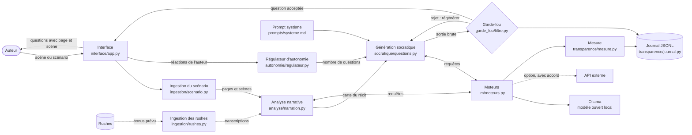
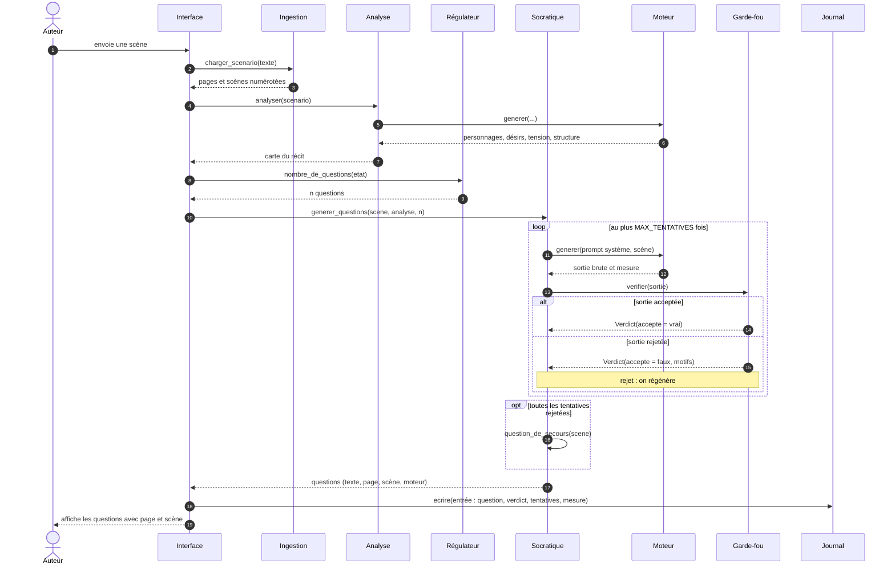
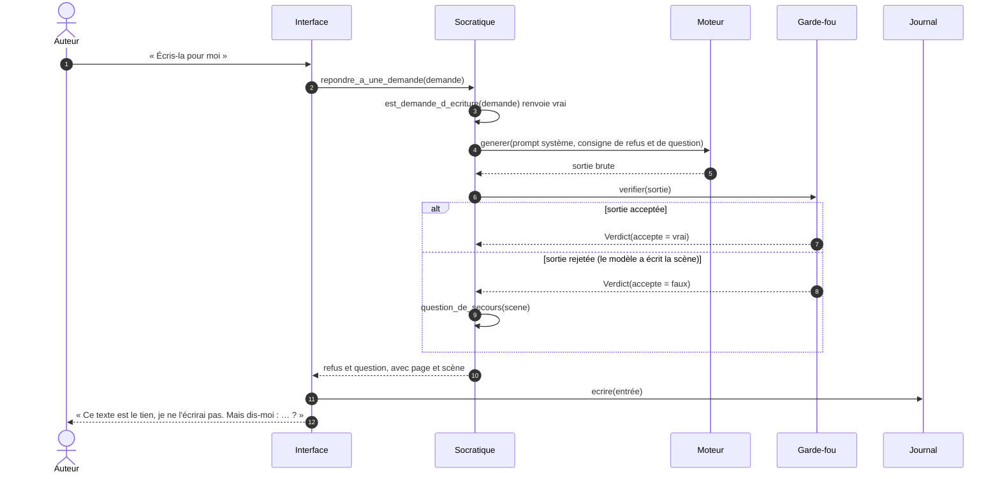
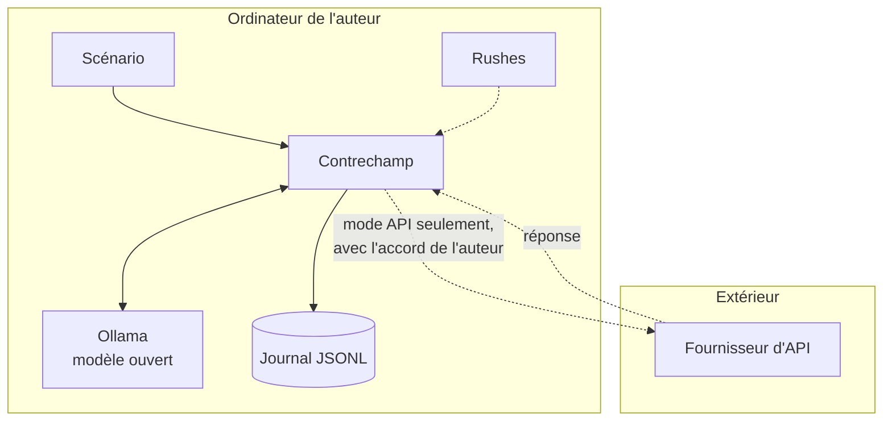

# Architecture de Contrechamp

> Statut : **en conception**. Ce document décrit l'architecture prévue. Aucun composant n'est encore implémenté.

Contrechamp lit un scénario et renvoie des questions. Il n'écrit jamais dans le scénario. Toute l'architecture est organisée autour de cette règle : la sortie du modèle de langage passe par deux sécurités avant d'arriver à l'auteur, et chaque question affichée est notée dans un journal local.

## Rôle de chaque composant

| Composant | Module | Rôle |
|---|---|---|
| Ingestion du scénario | `ingestion/scenario.py` | Lit le texte (derja en lettres latines, français, arabe) et le découpe en pages et en scènes numérotées. Ces numéros sont la source de chaque question. |
| Ingestion des rushes (bonus prévu) | `ingestion/rushes.py` | Transcrit les rushes en derja avec FarukSTT, en local, et les rattache aux scènes. |
| Analyse narrative | `analyse/narration.py` | Repère les personnages, ce qu'ils veulent, ce qui s'y oppose, l'évolution de la tension, et la structure du récit (dont celle du conte tunisien). Cette analyse nourrit les questions ; elle n'est jamais montrée comme un verdict. |
| Génération socratique | `socratique/questions.py` | Demande au moteur des questions sur la scène, en suivant le prompt système. Chaque question porte sa page, sa scène et le nom du moteur. Gère les demandes « Écris-la pour moi ». |
| Prompt système | `socratique/prompts/systeme.md` | Première sécurité : la consigne donnée au modèle (poser des questions, ne jamais écrire de dialogue, de scène ou de description). |
| Garde-fou | `garde_fou/filtre.py` | Seconde sécurité : relit chaque sortie sans faire appel au modèle et bloque tout ce qui ressemble à du texte de scénario. Voir [garde-fou.md](garde-fou.md). |
| Régulateur d'autonomie | `autonomie/regulateur.py` | Décide combien de questions poser. Le nombre baisse à mesure que l'auteur avance seul. |
| Moteurs de langage | `llm/moteurs.py` | Interface commune : modèle ouvert en local avec Ollama (par défaut), ou API externe en option, avec l'accord de l'auteur. |
| Mesure | `transparence/mesure.py` | Mesure le temps, les tokens et l'énergie estimée de chaque requête. |
| Journal | `transparence/journal.py` | Note chaque question dans un fichier JSONL local, avec sa source, le verdict du garde-fou et la mesure. |
| Interface | `interface/app.py` | Page web locale : envoyer une scène, lire les questions, régler l'autonomie, choisir le moteur, consulter le journal. |

## Diagramme des composants

## Séquence d'une session

L'auteur envoie une scène ; Contrechamp renvoie des questions, chacune avec sa page et sa scène.

## Séquence d'une demande « Écris-la pour moi »

Contrechamp ne fait jamais d'exception : il refuse et renvoie une question.

## Flux des données

Par défaut, **rien ne quitte l'ordinateur de l'auteur**.

| Donnée | Où elle est traitée | Où elle est gardée | Sort-elle de l'ordinateur ? |
|---|---|---|---|
| Scénario | Ingestion, analyse, génération (en local) | Nulle part par Contrechamp : il reste dans le fichier de l'auteur | Seulement en mode API, avec l'accord de l'auteur |
| Rushes (bonus prévu) | Transcription locale avec FarukSTT | Sur l'ordinateur de l'auteur | Non |
| Questions | Génération et garde-fou | Journal JSONL local | Non |
| Journal | Écrit en local | Dossier `CONTRECHAMP_DOSSIER_JOURNAL` | Non (l'auteur peut l'exporter ou l'effacer) |
| Mesures | Calculées en local | Journal JSONL local | Non |
| Clé d'API | Lue dans `.env` | `.env`, jamais publié (voir `.gitignore`) | Envoyée seulement au fournisseur choisi |

En mode API :

- l'auteur active le mode lui-même, et l'interface lui demande son accord explicite avant le premier envoi (`ConfigMoteur.accord_auteur`) ;
- seule la scène en cours et la carte du récit nécessaires à la question sont envoyées, pas le scénario entier ;
- Contrechamp ne garde rien chez le fournisseur et ne lui demande jamais d'utiliser les textes pour entraîner un modèle. À COMPLÉTER : vérifier les conditions d'utilisation du fournisseur retenu sur ce point ;
- l'auteur peut retirer son accord à tout moment : Contrechamp repasse alors en local.
