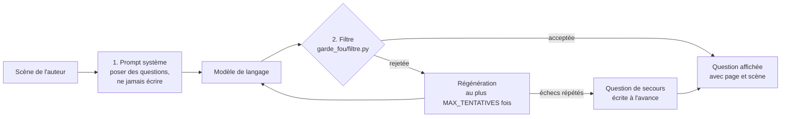

# Le garde-fou

> Statut : **en conception**. Le filtre n'est pas encore implémenté ; ses cas de test sont dans `tests/test_garde_fou.py`, marqués « à implémenter ».

La promesse de Contrechamp tient en une phrase : il n'écrit jamais une ligne à la place de l'auteur. Un modèle de langage peut désobéir à sa consigne, surtout si l'auteur insiste. Contrechamp a donc deux sécurités successives.

## Les deux sécurités

1. **Le prompt système** (`src/contrechamp/socratique/prompts/systeme.md`). Il donne au modèle une seule consigne : poser des questions courtes, chacune liée à sa page et à sa scène, et ne jamais écrire de dialogue, de scène ou de description. Il prévoit aussi le refus de la demande « Écris-la pour moi ».
2. **Le filtre** (`src/contrechamp/garde_fou/filtre.py`). Il relit chaque sortie avant qu'elle n'atteigne l'auteur. Il est fait de règles simples et ne fait **pas** appel au modèle : on ne demande pas à celui qui pourrait désobéir de juger sa propre désobéissance. Si la sortie est rejetée, `socratique/questions.py` régénère ; après `MAX_TENTATIVES` échecs, il affiche une question de secours écrite à l'avance. Chaque verdict est noté dans le journal.

## Les règles du filtre

| Règle | Motif (`Motif`) | Ce qui est bloqué |
|---|---|---|
| Réplique | `REPLIQUE` | Une ligne au format « NOM : … », avec un nom de personnage (souvent en capitales) suivi de deux-points et d'un texte. Le format scénario classique, avec le nom seul sur une ligne puis la réplique en dessous, est bloqué aussi. |
| Dialogue entre guillemets | `DIALOGUE_GUILLEMETS` | Une phrase entre guillemets (« », " ", “ ”) qu'un personnage pourrait dire. |
| En-tête de scène | `EN_TETE` | Une ligne qui commence par `INT.`, `EXT.` ou `INT./EXT.`. |
| Description | `DESCRIPTION` | Une phrase affirmative qui raconte ce que fait un personnage ou ce qu'on voit (« Leila entre dans la cuisine. »). |
| Sortie trop longue | `TROP_LONGUE` | Une sortie qui dépasse `LONGUEUR_MAX`. À COMPLÉTER : valeur à fixer pendant le prototype. |
| Pas une question | `PAS_UNE_QUESTION` | Une sortie qui ne contient aucune question (un verdict, un conseil, un résumé). |

Une sortie est bloquée dès qu'**une seule** règle est enfreinte, même si elle contient aussi une bonne question.

## Exemples

### À bloquer

| Sortie du modèle | Motif |
|---|---|
| `LEILA : Je ne partirai jamais.` | Réplique |
| `JEDDA : Khalliha testanna.` | Réplique |
| `« Je reste ici », murmure-t-elle.` | Dialogue entre guillemets |
| `INT. MAISON DE JEDDA - NUIT` | En-tête de scène |
| `EXT. COUR - JOUR` | En-tête de scène |
| `Leila entre dans la cuisine et pose les clés sur la table.` | Description |
| `La grand-mère s'assoit sur le seuil et ferme les yeux.` | Description |
| `Que garde-t-elle ici ? LEILA : Je ne partirai jamais.` | Réplique (cachée après une question) |
| `Cette scène manque de tension.` | Pas une question |
| Une question de plusieurs centaines de mots | Sortie trop longue |

### À accepter

| Sortie du modèle |
|---|
| `Que garde-t-elle ici ?` |
| `Qui veut qu'elle parte ?` |
| `Et si la maison refusait de la laisser partir ?` |
| `Que voit Jedda quand elle regarde les cartons ?` |
| `Une question : que garde-t-elle ici ?` (les deux-points ne suivent pas un nom de personnage) |

### Cas limites à trancher

- **Citer l'auteur.** Une question peut vouloir citer un mot déjà écrit par l'auteur : « Pourquoi Jedda dit-elle « khalliha » ? ». Ce n'est pas écrire un dialogue. À COMPLÉTER : règle exacte (longueur maximale de la citation, obligation qu'elle figure déjà dans la scène).
- **Derja et arabe.** Les règles doivent fonctionner sur la derja en lettres latines et sur l'arabe, où les capitales et les guillemets ne s'utilisent pas toujours de la même façon. À COMPLÉTER : cas de test en derja et en arabe, avec l'aide de locuteurs.
- **Description déguisée en question.** « Et si Leila entrait dans la cuisine, posait les clés et disait qu'elle ne partira jamais ? » est une question qui contient une scène. À COMPLÉTER : critère pour la repérer (longueur, nombre d'actions décrites).
